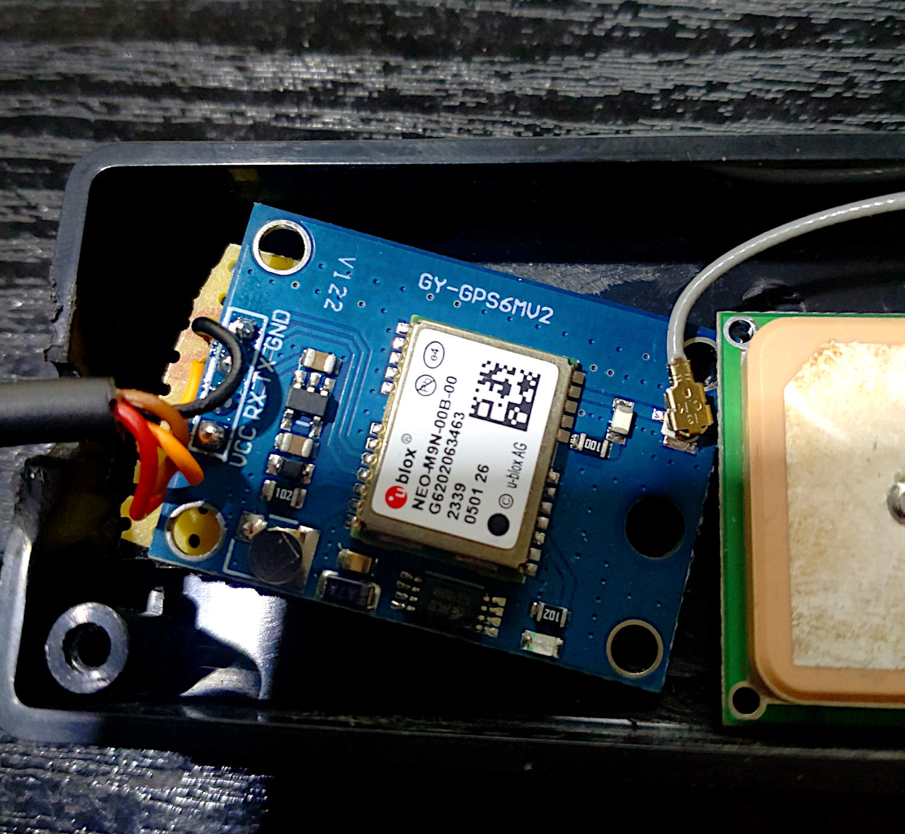
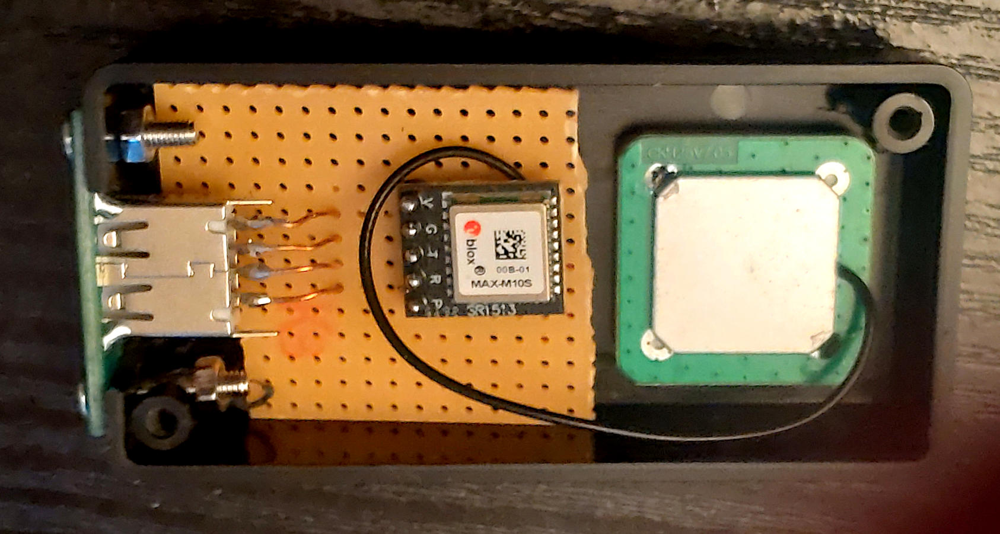
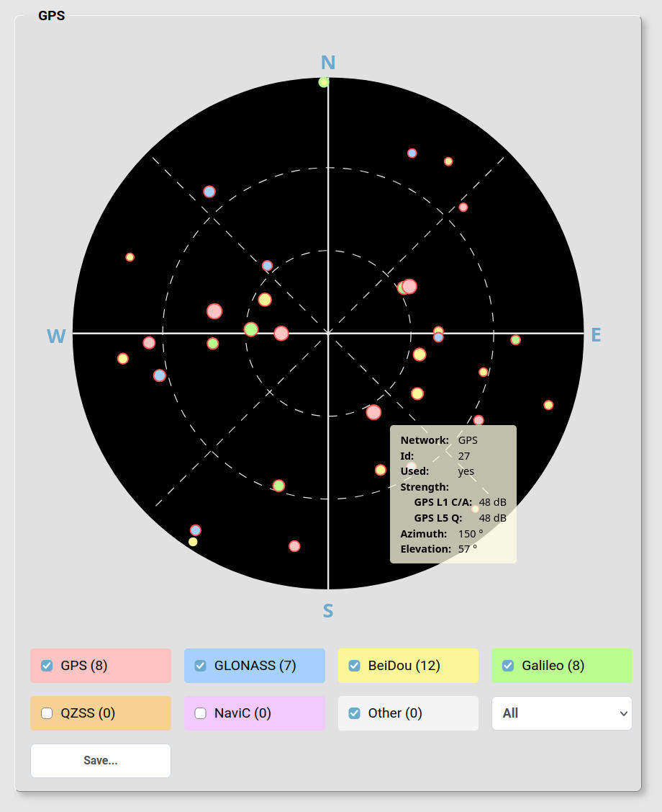
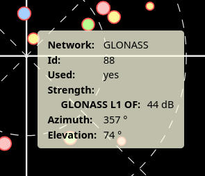

# GPS Monitor

GPS Monitor is a private project for displaying information received from a GPS receiver.

I run it on a Raspberry Pi 5 using a serial interface.

The project includes an NMEA parser, which has been tested with a u-blox NEO-M9N receiver.

The main page displays the most important GPS information. There is also a satellite view (skyplot), which is generated dynamically as an SVG using JavaScript. The SVG can also be exported.
When hovering over a satellite, a tooltip displays additional information.  

Additionally, a small map displays the current position.

In `gpsmonitor.js`, you can configure which map provider to use:

- MapLibre
- OpenStreetMap
- Google Maps (embedded via iframe)

Since Google Maps does not offer a free API for this purpose, I use the simple iframe approach.

To prevent unnecessary flickering, the map is only updated when the position changes by more than 10 metres.

## Tested reveivers

- ublox
  - Neo-M9N
  - MAX M10S
- Queltec
  - LC29HEA

Author: Reiner Pröls  
License: MIT  

## Photos

## Screenshots

")
")

## Links

- [Readme](https://bytemystery-com.github.io/gpsmonitor/)
- [Repository](https://github.com/bytemystery-com/gpsmonitor/)

© Copyright Reiner Pröls, 2026-2027

